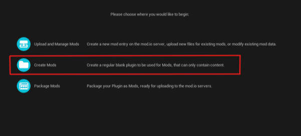
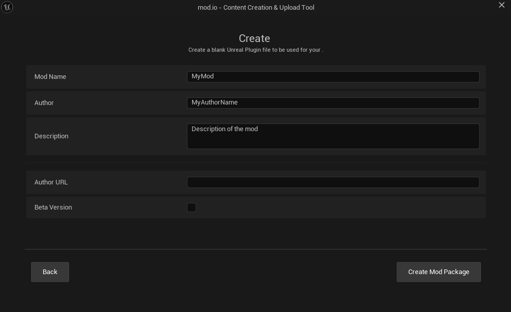
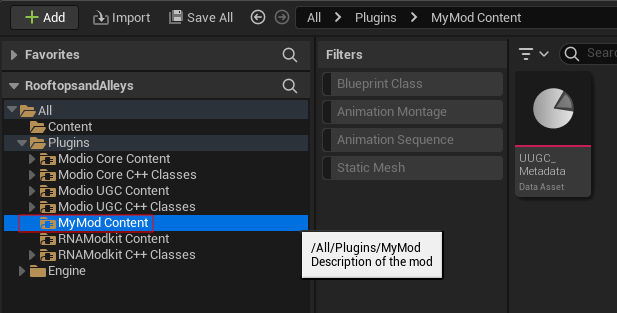
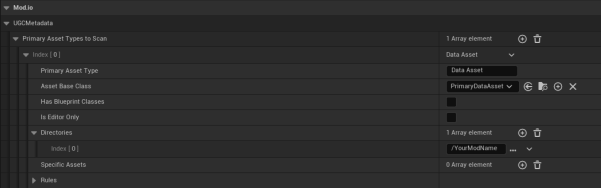
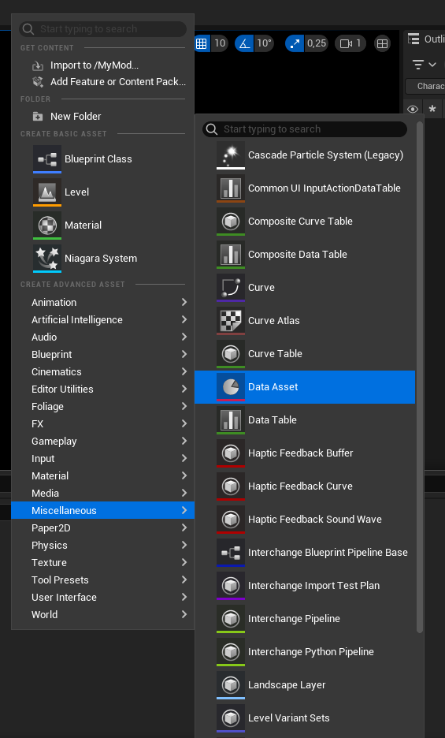
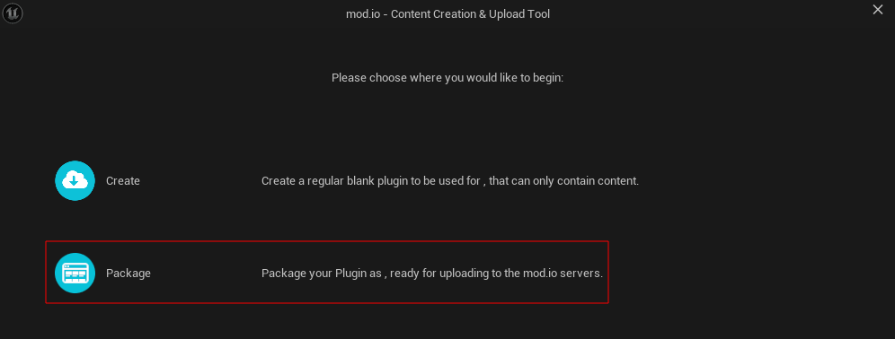
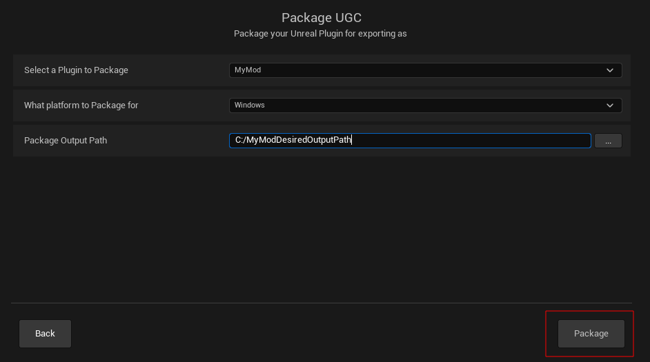
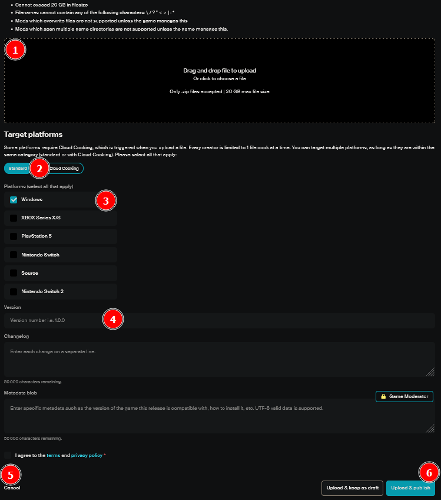
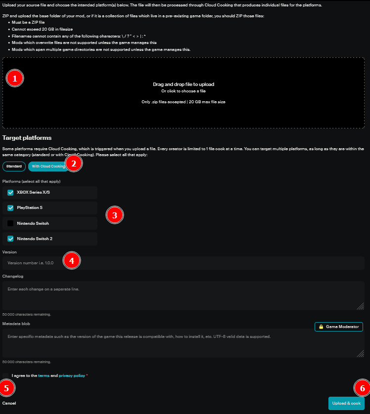

# Rooftops and Alleys Modding User Guide
The official Rooftops and Alleys modding support allows the following modifications:
- Add objects to the level editor.
- Add new Body parts to the character.
- Change the model and/or animations of the pigeon.
- Add whole unreal levels.

## Requirements
- **Unreal Version: 5.4**  
- **Modkit Version: 1.0.0**
  - [RooftopsandAlleysModkitTemplate-V1_0_0.zip](https://github.com/Shine-Publishing/Rooftops-and-Alleys-Modkit/releases/download/v1.0.0/RooftopsandAlleysModkitTemplate-V1_0_0.zip)

## Setup
- Download **Unreal Engine 5.4** from the Epic Games Store.
- Download the [Modkit](https://github.com/Shine-Publishing/Rooftops-and-Alleys-Modkit/releases/download/v1.0.0/RooftopsandAlleysModkitTemplate-V1_0_0.zip).
- Extract the Modkit in the directory of your choice.
- In the extracted directory, open `RooftopsandAlleys.uproject` with **Unreal Engine 5.4**.

## Mod creation video tutorial
https://github.com/user-attachments/assets/36b38606-020d-4cbe-8c40-0594d53b9956

## Mod creation
### Creating a blank mod
First you need to create a blank mod where you'll be able to put your content:
- At the top of the editor window, click on the **mod.io** widget  

- Select **Create** to create a new mod.  

- In the **Create** window, fill in the different information with at least the **Mod Name**, **Author**, and **Description**.  

- Then click on **Create Mod Package**.

### Metadata setup
Now, you can setup metadata for your mod (Required for Rooftops and Alleys modkit files to be discovered by mod.io):
- Open the **Content Browser** in the editor.
- Go to `Plugins/YourModName` content folder.  

- Edit the **UUGC\_Metadata** data asset by adding a **Primary Asset Types to Scan** configured like this:  
  - **Primary Asset Type:** `Data Asset`
  - **Asset Base Class:** `PrimaryDataAsset`
  - **Directories:** `/YourModName`  

### Populating mod content
Now, you can create your mod content. To do so, you can use the various **templates located in the RNAModkit plugin** (Which can be found in the editor content browser at `Plugins/RNAModkit`).  

  
You will find:
  - Skeletons of the body and the head of the player character
  - Animation Blueprint templates for the pigeon
  - And a Skysphere for your mod Levels. You need to use a skysphere for the Switch 2 compatibility of your level: *On mobile the SkyAtmosphere component needs a mesh with a material tagged as IsSky and using the SkyAtmosphere nodes to visualize the Atmosphere.*  
  You can use a different Skysphere than the one provided in the modkit if you want. [https://forums.unrealengine.com/t/help-completely-lost-with-the-message-on-mobile-skyatmosphere-needs-a-mesh-tagged-issky/252845](https://forums.unrealengine.com/t/help-completely-lost-with-the-message-on-mobile-skyatmosphere-needs-a-mesh-tagged-issky/252845)

### Referencing mod content
Once you have created the content for your mod, you need to reference it in one or more **Data Asset**, depending of what content your mod provide. This allow the modkit to discover the content you created.

There are 4 types of **Data Asset** in the modkit that you must choose from (One mod can contain multiple **Data Asset**):
  - **Mod Item Definition** (for a new level editor element)
  - **Mod Body Part Definition** (for a new character body part)
  - **Mod Pigeon Definition** (for changing the pigeon model)
  - **Mod Level Definition** (for a new Level)  

  
> **/!\\ The game only loads content through these Data Assets. You MUST include them for your mod to work. /!\\**

  
Create a data asset by following these steps:
- Open the **Content Browser** in the editor.
- Go to `Plugins/YourModName` content folder.  
- **Right click in the content browser** | **Miscellaneous** | **Data Asset**.  

- Select the right **Data Asset** type depending on your mod content (**Mod Item Definition**, **Mod Body Part Definition**, **Mod Pigeon Definition**, **Mod Level Definition**).

#### Filling level editor item definition data asset
- Item Name _(Name)_ → Name of the New Item
- Mesh _(StaticMesh)_ → Static Mesh of the New Item
- Thumbnail _(Texture2D)_ → Icon of the Item for the menu
- Materials _(Array of Materials)_ → Materials applied to the static mesh (Optional)
- Category _(Name)_ → Category of the Item: **_“Modding”_**

#### Filling body part definition data asset (Head, torso, bottom, shoes)
- Item Name _(Name)_ → Name of the New Item
- Thumbnail _(Texture2D)_ → Icon of the Item for the menu
- BodyPart _(List)_ → Select the Type of this body part
- Skeletal Mesh _(SkeletalMesh)_ → Skeletal Mesh of the new body part
- Feathers _(Integer)_ → Cost In feathers of the item (Optional)
- **Leave all other fields empty**

#### Filling body part definition data asset (Backpack, headwear, pigeon accessory)
- Item Name _(Name)_ → Name of the New Item
- Thumbnail _(Texture2D)_ → Icon of the Item for the menu
- BodyPart _(List)_ → Select the Type of this body part
- Static Mesh _(StaticMesh)_ → StaticMesh of the new Accessory
- Feathers _(Integer)_ → Cost In feathers of the item (Optional)
- **Leave all other fields empty**

#### Filling body part definition data asset (Trail)
- Item Name _(Name)_ → Name of the New Item
- Thumbnail _(Texture2D)_ → Icon of the Item for the menu
- BodyPart _(List)_ → Select the Type of this body part
- Feathers _(Integer)_ → Cost In feathers of the item (Optional)
- Niagara _(NiagaraSystem)_ → New Trail effect
- **Leave all other fields empty**

#### Filling body part definition data asset (Pigeon skin)
- Item Name _(Name)_ → Name of the New Item
- Thumbnail _(Texture2D)_ → Icon of the Item for the customization menu
- BodyPart _(List)_ → Select the Type of this body part
- Feathers _(Integer)_ → Cost In feathers of the item (Optional)
- Pigeon Skin _(Material)_ → New pigeon skin material
- **Leave all other fields empty**

#### Filling pigeon definition data asset
  - Name _(Name)_ → Name of the New Model
  - Thumbnail _(Texture2D)_ → Icon for the customization menu
  - Skeletal Mesh _(SkeletalMesh)_ → Skeletal Mesh of the model
  - ABP\_Default _(AnimationBlueprint)_ → Principal Animation Blueprint
  - ABP\_Pickup _(AnimationBlueprint)_ → Pickup Animation Blueprint
  - ABP\_NPC _(AnimationBlueprint)_ → Animation Blueprint played in the Menus
  - AM Barrel Roll R _(AnimationMontage)_ → Animation played on a Right Barrel Roll
  - AM Barrel Roll L _(AnimationMontage)_ → Animation played on a Left Barrell Roll
  - On top of those elements, your mod needs to contain: The **Skeleton** of your model, the **Physics Asset** of your model, and the various **Animation Sequences** used in your Animation Blueprints and Animation Montages, such as Diving, Flying, Standing, and Walking

#### Filling level definition data asset
  - Level Name _(Name)_ → Name of the New Level
  - Level _(UWorld)_ → Actual Unreal Level
  - Preview Image _(Texture2D)_ → In-game preview of the level
  - On top of those elements, your mod needs to contain **all the material and Static Meshes** used in the level

> **/!\\ To prevent the execution of outside code, the mod levels are sanitized, so we highly recommend that you prevent adding any Blueprint Class to your Mod Level and only use Static Meshes. /!\\**

## Distribute Your Mod
To distribute your mod:
- **Go to** [https://mod.io/g/rooftops-alleys](https://mod.io/g/rooftops-alleys).  
- Create an account or log in to an existing one. Then select **Add UGC** at the top of the page. Follow the instructions and be sure to tag your mod accordingly.

### For Windows
For Windows, you will need to package the mod yourself:
- At the top of the editor window, click on the **mod.io** widget.  

- Now Select **Package**.  

- Select your mod plugin, the **Windows** platform, and an output path, then click **Package**.  

- Now, using your computer file explorer, navigate to the output folder you gave to the **mod.io** widget.
- Enter in the directory called **YourModName_Windows**.
- Select the **Content** folder and the **.uplugin** file and compress them into a `.zip` archive.

Go back on the **mod.io** web interface, and when asked to upload files for your mod, select **Add a new file**. Upload your `.zip` archive, and under Target platforms select **Standard** and **Windows**.  
Don’t forget to **set the version number** of your mod; otherwise, it won’t get published!

If you make any changes to your mod in the future, you can re-cook it and re-package the resulting files. Then, on the **mod.io** web interface, go to **My Content | Mods** and click **Manage** on the mod you want to update.\
There, select **Add a new file**, upload your `.zip` archive, and select only the Windows platform.  
Don’t forget to **update** the version number of your mod.

### For Consoles
For consoles, we will package your mod for you.

First, make sure to package your mod **source files** into a `.zip` archive:  
- Go to the modkit directory
- Open the **Mods** subdirectory
- Open your mod folder
- Select the **Content** folder and the **.uplugin** file, and compress them into a `.zip` archive.

Go to the Modio web interface and create a new mod. When asked to upload files for your mod, select **With Cloud Cooking**, upload your `.zip` archive, and select all 3 platforms (PS5, XSX, and Switch 2). Your mod will be packaged and distributed for those platforms.  
Don’t forget to **set the version number** of your mod; otherwise, it won’t get published!

If you make any changes to your mod in the future, you can re-package your source files in a `.zip` archive. Then, on the **mod.io** web interface, go to **My Content | Mods** and click **Manage** on the mod you want to update.  
There, select **Add a new file**, upload your `.zip` archive, select **With Cloud Cooking**, and check the 3 platforms.  
Don’t forget to **update** the version number of your mod.

## Useful Links
Mod.io Documentation: [https://docs.mod.io/](https://docs.mod.io/)  
Mod.io UGC Documentation: [https://docs.mod.io/unreal/modio-ugc/getting-started](https://docs.mod.io/unreal/modio-ugc/getting-started)
